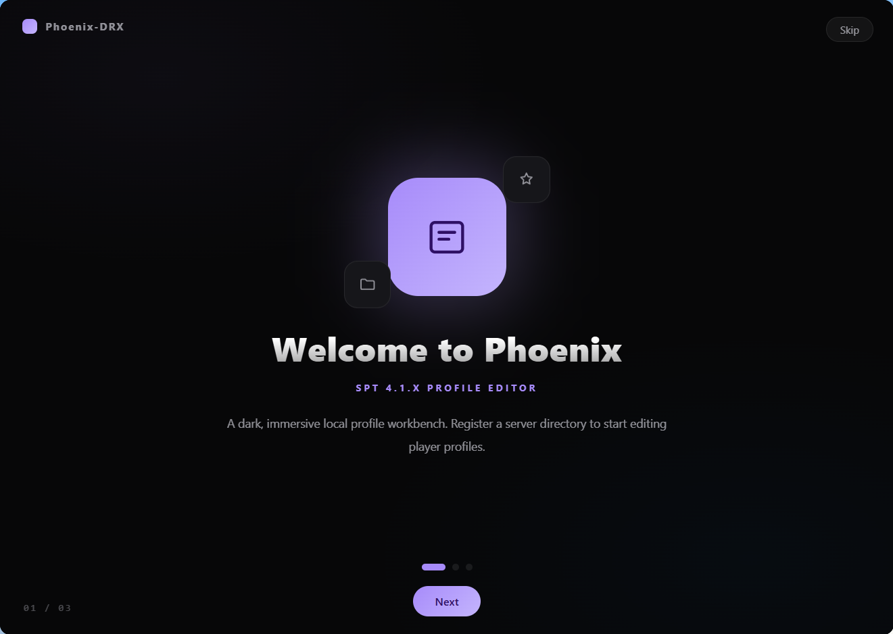
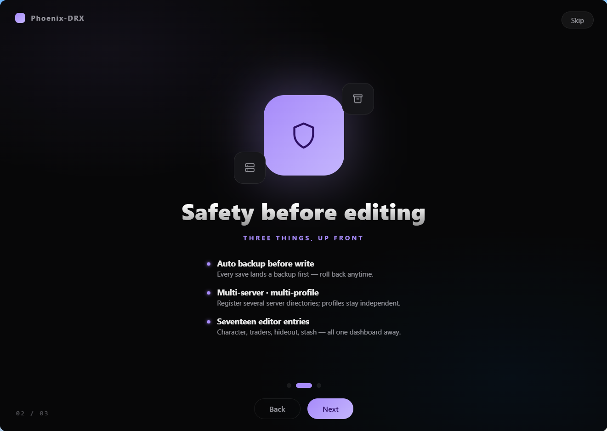

<!--
SPT Forge「Create Mod → Description」的源文件。
整段（HTML 注释之外）复制粘贴到 Forge 表单即可。
改版时不要动这里的功能清单，只改与版本无关的长期信息；
每版的更新说明另写在 Create Mod Version 的 Description 里（见发版流程）。
-->

A desktop editor for SPT 4.1.x profiles. It reads and writes the profile JSON on your own machine — no server mod, no game injection, no network calls.

[Features](#features) · [Install](#install) · [Data safety](#data-safety) · [Notes](#notes) · [Disclaimer](#disclaimer)

## Features

- **Character** — nickname, side, level & experience (bidirectional with the server exp table), appearance (head, voice, pockets), health read-out, gear preview.
- **Skills** — every common skill's progress, plus weapon mastering caps pulled from the server's own mastering table.
- **Traders** — loyalty level and sales sum for all 12 traders.
- **Quests** — status per quest (locked / active / complete / failed), including event quests, with the same integer status codes the server uses.
- **Hideout** — 28 areas, levels capped by the real `areas.json` stage table; only the level you touch is changed, everything else in the object is preserved.
- **Stash** — 10×68 grid view, add items by Chinese or English name / short name / template id, add money into existing stacks first.
- **Presets** — your own weapon and equipment builds, plus 12 curated loadouts rebuilt against real 4.1.6 data.
- **Inspector** — browse all 4673 items with ergonomics / recoil stats and build a preset from parts.
- **Problem scan** — checks level vs exp table, quest status consistency, and other mismatches.
- **Backups** — automatic backup before every write, 10 kept, one-click rollback.

## Screenshots

## Install

1. Download the `.zip` from the Download button.
2. Unpack it and run `Phoenix-DRX_<version>_x64-installer.exe`.
3. The installer detects and takes over an older installation in place, keeping your settings. It follows your Windows display language (Chinese or English).
4. On first launch, pick your SPT server root (e.g. `E:\EFT`).

Requires Windows 10/11 x64 and SPT 4.1.x.

## Data safety

Every write to your profile is preceded by an automatic backup:

`%APPDATA%\com.phoenix.drx\backups\<profileId>_<serverId>\`

The last 10 are kept. Roll back any time from the Backups page. The editor never writes to the server's own files, and never touches a profile while the game is running.

## Notes

- **Not a server mod.** Nothing goes into `user\mods\`. If the launcher shows an Install button that does nothing, that is expected — this tool is a standalone executable, so use Download instead.
- **Server should be closed while editing.** Writing a profile that the server has open will be overwritten on the server's next save.
- Free and open source, MIT. No activation, no VIP, no expiry.

## Links

- Source: https://github.com/65tiankehan/Phoenix-DRX-Code
- Releases: https://github.com/65tiankehan/Phoenix-DRX-releases/releases
- Website: https://65tiankehan.github.io/Phoenix-DRX/

## Disclaimer

Not affiliated with Battlestate Games or the SPT team. Back up your profile before editing and proceed at your own risk.

---

中文简介：SPT 4.1.x 存档编辑器。只读写本机存档 JSON，不是服务器 mod、不注入游戏进程。改角色/技能/商人/任务/藏身处/仓库/预设，每次写入前自动备份。永久免费、MIT 开源。
